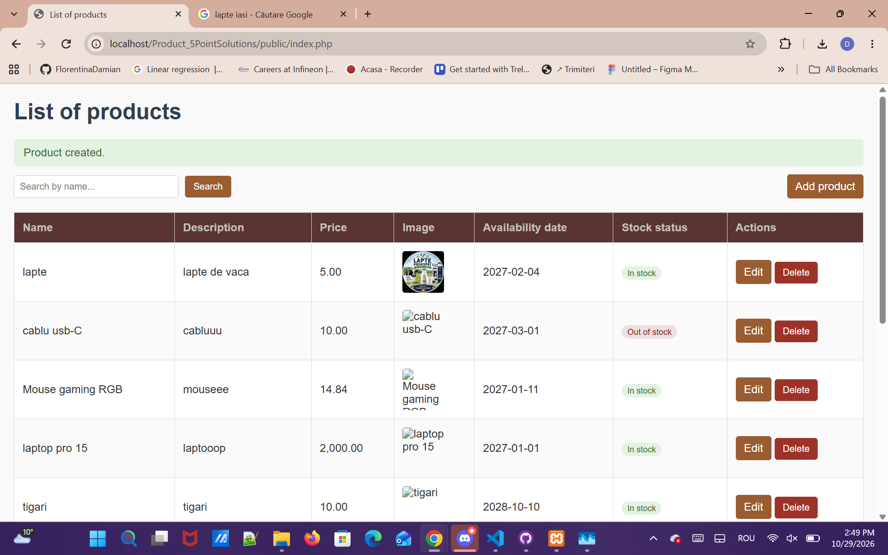
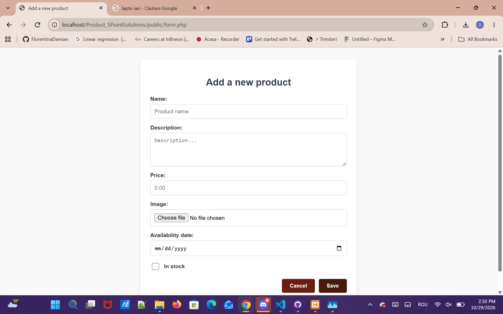
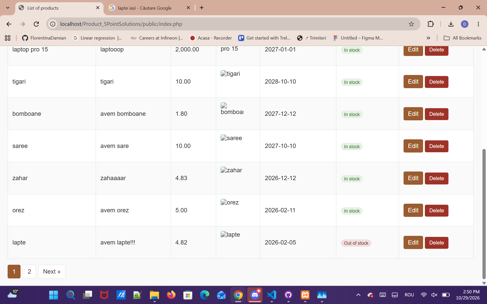
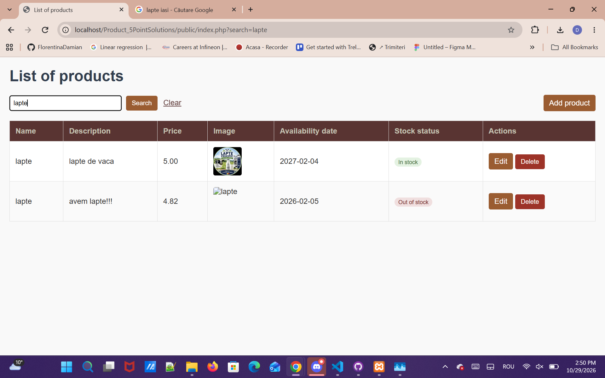

## Structure
- `public/index.php` – toolbar, list container, delete modal markup
- `public/form.php` –  create and edit form
- `public/partials/product-list.php` – table + pagination;
- `public/js/` – `app.js` (fetch helper, flash messages), `list.js` (live search, pagination), `delete-modal.js` (modal + AJAX delete), `product-form.js` (AJAX create and edit, inline errors, image preview/size check)
- `public/css/` – `common.css` (flash messages), `table.css`, `form.css` (both responsive: rows become cards on small screens)
- `src/controller/` – `ListProducts` and `ProductForm` (page logic, return data to the views), `AddProduct`, `UpdateProduct`, `DeleteProduct`, plus `validation.php` (server-side rules, image checks) and `session.php` (CSRF, escaping, flash/JSON helpers)
- `src/bd/` – PDO connection, table schema, and prepared-statement queries

## AJAX
Listing, search, pagination, create, edit and delete all work without a full page reload. Requests sent by `App.request()` carry `X-Requested-With: fetch`; controllers then answer with JSON (or, for the list, only the HTML fragment).

## Notes
- All SQL uses PDO prepared statements; 
- output is HTML-escaped; 
- POST actions are CSRF-protected.
- Images: JPG/PNG/GIF/WEBP up to 2 MB, content-type verified, stored under a random name; replaced/deleted images are removed from disk.

## Screenshots

